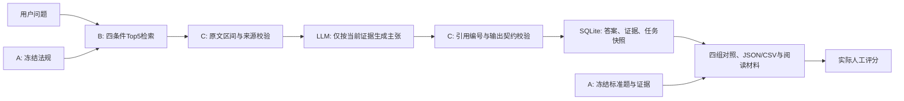

# C部分报告草稿：问答、引用与四组评估

状态：2026-11-20草稿。真实120项已运行，人工评分尚未完成，答案/引用/拒答正确率暂不填写；完成实际核验后才能纳入最终课程报告。该文件用于给组长汇总C部分，尚未发送或发布。

## 我负责的内容

A提供冻结官方语料与标准题，B实现固定窗口/结构感知分块、BGE-M3和Chroma检索，C负责将三方接入生产应用，并实现带引用问答、来源校验、会话与证据快照、持久化后台任务、四组评估、人工评分、导出与页面。普通问答和评估使用同一条后端链路。

标准答案、标准证据和可答标签只用于评估/评分，不进入生成提示。每条事实主张引用本轮证据编号，后端核验来源URL、文档/索引版本和Python字符区间，保留回答当时的原文快照。语法/位置核验保证引用可追溯，主张是否受证据支持仍由逐主张评分核验。证据不足与技术失败使用不同状态；失败与重试均留痕，不静默删题。

## 正式实验设置

5份EUR-Lex英文消费者权益法规，全部为A交付的原始公布版，不是当前合并修订版。冻结全文391777字符、121主条文；A的30题含24可答、6拒答、42段证据，至少覆盖课程要求的20组问答。

四组为固定窗口F400/F800与结构感知S400/S800，字符目标400/800，Top5、余弦度量。BGE-M3固定revision 5617a9f61b028005a4858fdac845db406aefb181，1024维、CPU、同一权重哈希；四组共3515块，分别982/1415/493/625。生成模型CS5351/DeepSeek-V4-Flash，temperature=0，固定提示词与输出预算。所有组共享同一冻结语料/题集/索引/生成配置。

A的正式导出保留章、节、段落及来源元数据，C新增只读内存适配，向B仍传完整原始字典。附件题保留structure_id，用A已验收结构的原始SHA、全文SHA、附件区间和逐字切片校验；未将附件伪造成主条文、改题或重算gold版本迁就结果。

## 实际结果与口径

Hit采用同文档区间并集完整覆盖标准证据，any表示至少一段，all表示全部，分母固定24。编号等字符属于冻结证据的一部分。6道拒答题不混入命中率分母。

| 条件 | 块数 | Hit@1 any | Hit@1 all | Hit@5 any | Hit@5 all | 可答题被拒答 |
| --- | --- | --- | --- | --- | --- | --- |
| F400 | 982 | 5/24 | 1/24 | 9/24 | 4/24 | 5 |
| S400 | 1415 | 7/24 | 4/24 | 14/24 | 6/24 | 6 |
| F800 | 493 | 10/24 | 4/24 | 17/24 | 10/24 | 6 |
| S800 | 625 | 14/24 | 8/24 | 21/24 | 13/24 | 3 |

这套冻结题中S800的完整证据覆盖最多。120项全部完成，技术失败0；实际121次尝试，一次服务暂不可用后有界重试成功。已知186241token，一次失败尝试无usage，未知项保留，金额未知。实际返回模型一致，无模型漂移。6道应拒答题在四组都返回insufficient；该观察不能替代实际拒答评分。

人工答案/拒答待评120项，带引用主张共166条（F400 36、S400 35、F800 45、S800 50），逐主张支持判断也尚待填写。当前answer_accuracy/refusal_accuracy/citation_accuracy的value为null，formal_results=false，不将待评项目写成0%或最终成绩。

## 可用于讨论的真实案例

- gold-sgd-price-reduction：前三组返回证据不足，S800取回完整Article15并引用回答，展示策略对证据可用性的影响。
- gold-ucpd-pyramid-scheme：F400出现cannot方向相反主张，说明可追溯引用仍需语义核验；S400取回核心内容但漏标准证据编号，严格覆盖指标为false，说明该口径与语义充分性不同。原题、证据和既定指标保持不变。

这些是Codex对已保存输出的辅助观察，未写入正式人工评分。对答案正确性作结论前，应实际对照必要事实与每条引用。

## 验证与可复现性

Windows完整401项通过；Linux新镜像400项通过/1Windows专用跳过，生产HTTP和12次真实CPU检索通过。正式Windows端到端在正常app.main中建四索引、真实学校问答、保存后新进程恢复和formal预检通过。正式120项独立ask/会话、题集快照和来源切片均核对；重启后JSON/CSV字节完全一致。每个阶段有工作日志、交接和answer-eval本地提交；未push或改main。

正式Linux也完成空卷重建3515块四索引、学校单题和重启；Windows120项在禁网/无Key的Linux正常应用中恢复，两次导出逐字节一致，未重复生成120题。离线候选镜像/权重已归档并校验，异机load尚待接收端验证；准确率和最终带评分结果仍需实际人工核验。模型、冻结资料、配置、原始结果和哈希均保留；私密env不进入Git、镜像、日志或模型消息。外部模型措辞可能变动，保存的原始结果用于核验已有实验。

## 最终报告还要补什么

由实际评审人在已有run_id完成答案、拒答及166条主张评分，保存后重新导出并填写准确率、分子/分母和典型失败原因。随后完成M7最终镜像/权重/数据/结果归档及哈希，全组再确认提交与展示要求。当前不发布“全部完成”的结论。
