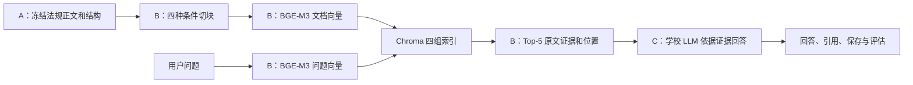

# DERag 项目工作文档：大白话理解、B 任务分析与 TA 答辩准备

整理日期：2026-11-20。用途：下周 pre 前复习、现场演示和回答 TA 提问。

这份文档按你的要求使用中文，界面和其他已翻译的项目说明仍使用英文。文中的“我的工作”指你负责的 **B：分块、向量化、索引和检索**，A、C 的工作会单独说明。

本次数字只对应这次本地实验 `eval-ca61c0c0f4bc40339a321e93d80d0e45`。不要混用仓库旧报告里 S800 的 `13/24`；**这轮保存后的 S800 是 `14/24`**。评分由用户授权 Codex AI 辅助填写，120 条记录均不是逐项人工确认的独立评分。

## 0. 怎么读这份文档

- 只有 10 分钟：读第 1、2、5、7 节，再练第 9 节的讲稿。
- 有半小时：加上第 8 节失败案例和第 11 节 TA 模拟问答。
- 演示前：照第 10 节走一遍，先准备好离线结果页。
- 准备交付：看第 12、13 节，分清源码、模型、结果和数据库备份。

### 最先记住这八句话

1. 我们做的是一个**带来源引用的法规知识库问答系统**。
2. 知识库来自 **5 份 EUR-Lex 官方英文消费者权益指令**，共 121 条主条文。
3. A 整理资料和标准题，**B 把资料切块、建立向量索引、找到相关原文**，C 调用大模型回答并组织评估。
4. B 比较“固定窗口”和“法条结构感知”，每种做 400、800 两档，合计四组。
5. **400/800 是字符，不是英文单词，也不是模型 token**；两种方法在本项目中都不重叠。
6. B 用 BGE-M3 把文本变成 1024 维向量，存进 Chroma；提问时取最相关的 Top-5 片段。
7. 30 道题是考试题，不是训练数据；四组各答一次，得到 120 条记录，跑完就结束。
8. 本轮 S800 最好，但只是这批题、这套配置和这次运行的结果；不是证明它对所有问题都最好。

## 1. 我们到底做了什么

想象 TA 给你五本很长的法律教材，然后问一个问题。你不能凭印象乱答，要先找到有关段落，再用自己的话回答，而且要指出“我依据的是哪本书的哪一段”。

我们的系统做的就是这件事：**先查资料，再组织答案，最后把证据给用户看。**

这个流程叫 **RAG：Retrieval-Augmented Generation，检索增强生成**。

你可以把它理解为“给大模型开卷考试”。知识库是教材，B 是负责翻书找材料的人，大模型负责根据找到的材料写答案。材料不够时，系统应该说无法回答，而不是硬编。

这里有两个不同的模型：

| 名称 | 在本项目里做什么 | 大白话 |
|---|---|---|
| BGE-M3 | 把文档块和问题编码成向量 | 帮我们判断哪些段落与问题意思接近 |
| 学校 API 的 DeepSeek-V4-Flash | 根据检索到的原文生成带引用的回答 | 根据翻到的资料组织语言 |

**我们没有重新训练这两个模型，也没有用 30 道题微调它们。**

## 2. A、B、C 怎么分工

| 成员 | 负责的事情 | 给后续模块的东西 |
|---|---|---|
| A | 收集官方资料、清洗正文、标出章和条文位置、准备标准题与证据 | 冻结原文、结构 JSON、来源与哈希、30 道题和参考答案 |
| **B：你的重点** | 两种分块、BGE-M3 编码、四组 Chroma 索引、检索、分块和检索对照 | 能定位回原文的文档块及 SearchHit |
| C | 接入 LLM、限制答案依据、校验引用结构、保存会话、运行评估、评分和导出、接入页面 | 用户看到的问答与评估系统 |

A 和 C 说的 30 道题是**同一套题**：A 出题和准备标准答案，C 让系统做题并保存评估。B 的检索结果直接影响 C 有没有足够资料回答。

讲个人贡献时可以说：

> 我负责 B 模块：实现两种切块方法和四组对照，把文档块用同一个模型向量化并持久化到 Chroma，提供可追溯的 Top-5 检索结果，再通过真实模型与自动测试验证链路。

不要把 A 的官方资料核验、30 道标准题编写，或 C 的整个问答与评估平台都说成 B 的独立工作。

## 3. 我们的知识库是什么

来源是欧盟官方法律网站 EUR-Lex，采用已经保存并冻结的**英文原始公布版本**。

| 指令 | 主题 | 主条文数 |
|---|---|---:|
| 2011/83/EU | 消费者权利：撤销、交付、退款等 | 35 |
| 2019/770 | 数字内容与数字服务 | 27 |
| 2019/771 | 商品买卖及不符合合同的救济 | 27 |
| 2005/29/EC | 误导、侵略性等不公平商业行为 | 21 |
| 93/13/EEC | 不公平消费者合同条款 | 11 |
| **合计** | **5 份指令** | **121** |

清洗后的总正文长度为 **391,777 个 Python 字符**。正文还包含序言、附件等内容，因此“121 条主条文”不等于“全文只有 121 个段落”。

“冻结”就是把本次实验使用的材料固定下来，记录文件和版本哈希。以后官网改了内容，我们仍能知道这轮实验到底用了哪一版。

演示时要说“对这五份冻结指令做知识库实验”，不要说“系统掌握了所有欧盟法律”或“使用的都是最新合并修订文本”。

## 4. 系统运行时分成两件事

### 4.1 先建库：把教材整理成可以快速查找的卡片

1. 读取 A 的冻结正文和条文位置。
2. 用四种条件分别切成小块。
3. 用 BGE-M3 把每块文字变成向量。
4. 把向量和来源位置写进 Chroma，并导出块记录。
5. 核对四组全部完成后，才允许查询这个索引版本。

### 4.2 再提问：拿问题去找卡片，然后回答

1. 用户输入问题，选择一种分块方案。
2. 用同一个 BGE-M3 把问题变成向量。
3. 在该方案的索引中找 Top-5 相近的块。
4. B 返回原文、文档名、条号、起止位置和版本等信息。
5. C 把问题与这些证据交给学校 LLM，保存回答和引用。



**建库不是训练模型。** 我们算的是已有模型对文本的表示，没有更新模型权重。

## 5. 我的 B 任务，具体做了什么

### 5.1 四组实验配置

| 简称 | 方法 | 字符上限 | 本轮块数 | 平均块长 |
|---|---|---:|---:|---:|
| F400 | 固定窗口 | 400 | 982 | 399.0 |
| S400 | 法条结构感知 | 400 | 1,415 | 276.9 |
| F800 | 固定窗口 | 800 | 493 | 794.7 |
| S800 | 法条结构感知 | 800 | 625 | 626.8 |

合计保存 **3,515 个逻辑文档块**，对应四个 collection。四组分别覆盖同一套正文，不是把全文分给四组各看一部分。

### 5.2 固定窗口：按尺子切

比如 F400，基本就是 `[0,400)`、`[400,800)`、`[800,1200)` 这样往后切，最后一块可以不足 400。

优点是规则简单、容易复现、块大小整齐。缺点是“不管你这句话有没有说完”，因此可能把一个必要条件切到下一块。

例如原文是：

> 如果某个条件成立，消费者可以解除合同，并且经营者必须退还全部款项。

如果检索只拿到“消费者可以解除合同”，没有拿到前提或退款义务，后面的 LLM 就可能答不完整。

### 5.3 结构感知：尽量沿着条文、段落和句子切

它不是调用另一个 LLM 判断哪里语义完整，而是**确定性的规则算法**：

1. 主要利用 A 已标注的 Article 起止位置。
2. Chapter、Section 等章/节边界不能随意跨过去。
3. 同章同节里，小的完整单元能一起装进上限，就合并。
4. 一个条文太长，就优先沿段落、换行和句末标点继续拆。
5. 连单句都超过上限时，最后仍会按字符硬切。

因此它叫“尽量保留结构”，**不能说“保证每块都是一个完整法条”或“永远不会切断句子”**。

这轮的具体证据：

- S400 发生 **113 次超长句硬切回退**。这是触发回退的事件数，不是 113 道题、113 篇文档，也不是直接等于 113 个输出块。
- S800 的超长句硬切回退为 **0 次**，只说明这批语料在该上限下没有触发这种回退，不代表条文完全不需要拆分。
- S400 最短块只有 **1 个字符**。为保持章/节边界和原文的完整覆盖，极短标题/空白片段可能单独保留；这也是后续可以研究的质量与追溯性权衡。

### 5.4 为什么 400/800 不是单词数

我们按 Python 的 `len(text)` 计算字符。英文字母、空格、标点、换行都占字符。

`legal rights` 是两个单词，但按当前计算方式有 12 个字符。模型自己的 token 又是另一套切法，不能把 400 字符说成 400 个 token。

所有方法都**不重叠**，完整覆盖正文一次。没有悄悄丢掉空白、重复片段或重新清洗文字。

### 5.5 Embedding：把意思变成可比较的数字

可以把向量想成一张“意思坐标卡”。意思相近的问题和段落，希望在这个空间里比较接近。

当前正式配置：

| 项目 | 实际值 | 你需要理解的意思 |
|---|---|---|
| 模型 | `BAAI/bge-m3` | 使用现成的开源 embedding 模型 |
| 固定 revision | `5617a9f61b028005a4858fdac845db406aefb181` | 不让每个人随手下载到不同版本 |
| 向量维度 | 1024 | 每块得到 1024 个数字；不是 1024 个词 |
| 归一化 | 开启 | 使比较更稳定，主要比较方向 |
| 池化 | CLS | 使用这个固定模型管线的 CLS 表示 |
| 输入限制 | 8192 tokens | 真正超限会报错，不静默截断证据 |
| 设备 | CPU | 当前正式配置没有依赖 GPU |

问题和文档块使用同一个模型及匹配的配置。虽然 BGE-M3 还支持其他能力，**本实现用的是 1024 维稠密向量检索，没有实现它的稀疏检索或多向量检索**。

### 5.6 Chroma：保存卡片坐标，并快速找相近内容

四个 collection 分别是 `kb_f400`、`kb_s400`、`kb_f800`、`kb_s800`。

文档块的向量、块 ID 和位置等元数据持久化在 Chroma；完整块文本和条文关联同时保存在 JSONL 导出中。查到 ID 后，再从权威块记录和冻结正文补齐证据。

当前使用 cosine 距离，页面显示的分数是 **`1 - distance`**。分数越高表示向量上越接近，不是答案正确概率，更不是“0.64 就代表 64% 答对”。

Chroma 使用 HNSW 近似索引。因此严格说是“近似语义 Top-5”，不能承诺和全库精确暴力计算的前五名永远完全一样。

### 5.7 Top-5 返回的不是答案，是证据

B 主要返回以下信息：

| 字段 | 大白话 |
|---|---|
| `document_id` | 来自哪份法规 |
| `chunk_id` | 哪一张卡片 |
| `start`、`end` | 在冻结正文中的位置 |
| `text` | 这一块的原文 |
| `article_ids`、`article_labels` | 覆盖哪些条文，可能不止一条，也可能没有主条文标签 |
| `score`、`rank` | 向量相似分数和检索排名 |
| `corpus_version`、`index_version` | 哪版资料、哪版索引 |
| `source_url` | 官方来源地址 |

Top-5 不一定全来自同一份法规。主题相近的数字服务和商品买卖条文可能同时出现，这也是相似法规间混淆的来源。

### 5.8 为什么原文位置很重要

比如 `[75200,75600)`，意思是从字符下标 75200 开始，到 75600 之前结束，长度是 400。

B 会核对：

```python
chunk["text"] == document["text"][chunk["start"]:chunk["end"]]
```

这能证明“这段文字确实来自该冻结正文”。但它不能单独证明“这段文字足够支持模型的整句结论”，后者还需要语义判断。

我们不在切块时调用 `strip()` 或替换换行，否则位置会和 A 的标注错开。浏览器高亮也按 Unicode 字符处理，避免直接按 JavaScript UTF-16 长度切片而对不齐。

### 5.9 我做的不只是一个检索按钮

- **版本约束**：把语料、分块算法、模型身份和向量库配置纳入索引版本材料，避免拿错库。
- **稳定块 ID 与 upsert**：同一版本、方法、大小、文档和区间会得到相同 ID；重复写入覆盖记录，不产生重复逻辑块。
- **完整性检查**：无漏字、无重复覆盖、无越界、不超过字符上限，文本与原文切片一致。
- **四组完成后才发布**：建到一半不能假装正式索引已就绪。
- **可复用**：已有兼容且校验通过的索引可复用；同次建库中，相同文本可以复用编码结果。
- **区分 mock 与 real**：mock 用来测接口和流程，不能拿它声称语义检索有效。
- **持久化与释放资源**：有真实 Chroma 保存/重开验证，及时关闭客户端；针对单条写入落盘边界做了幂等 checkpoint 处理。
- **明确报错**：模型缺失、输入超长、版本不匹配、索引未完成、Windows 路径过长等都明确失败，不悄悄换成假数据。

### 5.10 TA 问源码时，优先打开这些文件

| 文件 | 关键入口 | 用一句话解释 |
|---|---|---|
| `app/retrieval/chunking.py` | `chunk_document`、`_structured`、`_split_large`、`validate_coverage` | 怎么切、如何处理长条文、怎么保证没改原文 |
| `app/retrieval/embedding.py` | `LocalEmbedder.identity`、`encode` | 模型固定、文件校验、编码和 token 超限检查 |
| `app/retrieval/indexes.py` | `build_indexes`、`completed`、`verify` | 四组建库、版本与完成状态、JSONL 和库内 ID 校验 |
| `app/retrieval/vector_store.py` | `ChromaStore`、`query`、`upsert` | Chroma 封装、cosine/HNSW 与持久化 |
| `app/retrieval/service.py` | `search_result`、`compare` | 问题编码、Top-5、证据补齐与对照 |
| `app/api/search.py` | `/api/search`、`/api/compare` | 对外 HTTP 接口 |
| `scripts/build_indexes.py` | CLI 入口 | 用正式配置构建四组索引 |

不要从头逐行背源码。先指着流程讲“输入是什么、输出是什么、哪里校验”，TA 追问再展开。

## 6. 30 道题和 120 条结果是什么意思

30 道题是预先冻结的考卷：**24 道有答案、6 道资料不足应该拒答**。

每种方案做同一套 30 题，所以：

```text
F400：30 条
S400：30 条
F800：30 条
S800：30 条
合计：120 条评估记录
```

这不是 120 个不同的问题，也不是训练了 120 次模型。

点击一次 `Run evaluation`，后台做完一轮就结束。查看、评分、导出只是读取保存的结果。再次点击运行才会再做一轮。

本轮有 **121 次生成尝试**：S800 第 1 题出现一次超时，随后重试成功，所以最终仍是 120 条完成记录、0 条最终技术错误。不要把“0 最终错误”说成“过程中从没失败过”。

## 7. 本轮实验结果怎么讲

### 7.1 B 最直接的证据：检索覆盖

`Hit@1` 看前一块，`Hit@5` 看前五块。`any` 表示至少一段标注证据被完整覆盖；`all` 表示这题全部标注证据都被完整覆盖。

覆盖按**同一文档内的字符区间并集**计算，多个块可以共同覆盖一段证据。不是只要搜到同一篇文章、出现同一个词就算命中，也不跨不同文档拼接区间。

| 方案 | Hit@1-any | Hit@1-all | Hit@5-any | **Hit@5-all** |
|---|---:|---:|---:|---:|
| F400 | 5/24，20.8% | 1/24，4.2% | 9/24，37.5% | **4/24，16.7%** |
| S400 | 7/24，29.2% | 4/24，16.7% | 14/24，58.3% | **6/24，25.0%** |
| F800 | 10/24，41.7% | 4/24，16.7% | 17/24，70.8% | **10/24，41.7%** |
| S800 | 14/24，58.3% | 8/24，33.3% | 21/24，87.5% | **13/24，54.2%** |

对 B 最重要的结论是：**在这次实验里，S800 的 Top-5 完整证据覆盖最高。**

- 400 档：结构法比固定法多完整覆盖 2 题，提升约 8.3 个百分点。
- 800 档：结构法比固定法多完整覆盖 3 题，提升 12.5 个百分点。
- 固定法 400 到 800：多完整覆盖 6 题。
- 结构法 400 到 800：多完整覆盖 7 题。

### 7.2 整个问答系统的结果

这些答案和引用等级来自**用户授权的 AI 辅助评分**，按 A 冻结必要事实采用较严格的完整性口径；不是独立人工金标准。

| 方案 | 完整正确/24 | 部分正确 | 错误 | 其中误拒答 | 正确拒答/6 | 引用支持/实际主张 |
|---|---:|---:|---:|---:|---:|---:|
| F400 | 6/24，25.0% | 10 | 8 | 5 | 6/6 | 28/35，80.0% |
| S400 | 9/24，37.5% | 9 | 6 | 6 | 6/6 | 33/35，94.3% |
| F800 | 10/24，41.7% | 7 | 7 | 6 | 6/6 | 43/46，93.5% |
| S800 | **14/24，58.3%** | 7 | 3 | 3 | 6/6 | **50/50，100.0%** |

96 条可答记录共 **39 条完整正确、33 条部分正确、24 条错误**，其中 **20 条是有答案却拒答**。24 条应拒答记录全部正确拒答。

引用一共检查 166 条实际生成的事实主张，其中 154 条被判支持、12 条不支持。引用分母不是 120，也不是 600：一题可能有多条主张，拒答则没有事实主张。

**不要把 6/6 的拒答正确率，拿来掩盖可答题的误拒答。**

### 7.3 B 的结论应该怎样说

可以这样说：

> 在固定语料、同一 embedding 和 Top-5 配置下，结构感知 800 字符在本轮的完整证据覆盖和完整回答数量上最好。它更容易保留相关法律条件，为生成阶段提供较完整的上下文。但仍有检索遗漏和生成遗漏，不能称为完美方案。

再深入一点：

| 方案 | Top-5 上下文字符数中位数 | 检索阶段耗时中位数 |
|---|---:|---:|
| F400 | 2,000 | 190.3 ms |
| S400 | 1,568.5 | 179.1 ms |
| F800 | 4,000 | 184.1 ms |
| S800 | 3,391 | 187.4 ms |

同样是 800 上限，S800 不是靠实际塞入比 F800 更多的字符取得这个结果。这支持“内容如何组织很重要”的观察。

但是，我们固定的是 Top-5 和字符上限，**没有让四组实际 token 预算完全相同**。因此不能声称已经严格排除了上下文长度等因素的影响。更强的后续实验应补上等 token 预算对比。

耗时是这台机器一次运行记录的阶段数据，不是全平台性能承诺。检索计时不等于浏览器到服务器再返回的端到端延迟。当前 CPU 首次正式建库约 **26 分钟**；已有索引可复用，不是每次提问都要等 26 分钟。

## 8. 用真实失败案例解释项目

### 案例 A：第 17 题，结构和大小为什么重要

问题：什么情况下，一个商业行为在 Article 5(2) 的一般测试下属于不公平？

完整答案要连接“违反专业勤勉”和“实质扭曲或可能扭曲经济行为”，并交代平均消费者或特定群体标准。

- F400、F800 的绑定引用在 `it materially distorts` 处截断，不能完整支持后面写出的法律条件；整答也漏了特定群体标准。
- S400 在这题拒答。
- S800 找到了完整的一般测试并回答正确。

你可以说：

> 这个例子说明，有时大模型不是不会组织语言，而是进入上下文的规则本身已经被截断。B 要解决的就是如何让证据更完整地进入 Top-5。

### 案例 B：第 8 题，截断后错误补词

F400 的引用停在 `nature of the` 附近，回答把后面的对象写成“合同的性质”。原法说的是“瑕疵的性质”。

这不是语言小错误，因为它改了法律例外。B 的片段边界有风险，生成模型又补出了错误名词，两方面共同形成失败。

### 案例 C：第 2 题，找到证据仍可能漏答

F800 的 `Hit@5-all` 为真，说明标准证据被前五块完整覆盖，但答案仍漏掉“退货或提供寄回证明前可以暂缓退款”的必要条件，只能评为部分正确。

你可以说：

> 检索覆盖和回答完整性必须分开测。B 把材料找全，并不自动保证生成模型把全部必要事实都写出来。

S800 也有一题“全部标准证据覆盖，但答案部分正确”的情况。因此不能把所有错误都归到 B。

### 案例 D：第 12、13、19 题，全组误拒答

这三题在四组中都拒答，但冻结知识库里有参考答案。四组 Top-5 都没有完整覆盖该题全部标准证据。

这提示检索覆盖存在共同短板，不能只在提示词里要求模型“自信回答”。需要查看实际片段，研究更合适的召回方式、必要的相邻上下文或元数据利用。

“没有完整覆盖”也不等于“检索结果完全没用”。例如第 19 题有些组命中了部分标准证据，但不足以给出全部价格信息条件。

### 案例 E：第 1 题，为什么没命中也可能答对

F400 的 `Hit@5-all` 为假，但答案被评为完整正确。原因是命中指标要求标注区间逐字符完整覆盖，固定块截掉的开头可能使它不满足这个标准；剩余片段结合题干仍可能足以形成正确答案。

所以 **Hit@5 是严格的证据覆盖指标，不是直接等同于答案正确率**。

### 案例 F：引用 100% 为什么仍只有 14/24 正确

S800 的 50 条实际主张都有引用支持，但某些回答少写了必要条件，另有三道可答题拒答。

“说出来的句子有依据”和“把这道题该说的内容都说全了”是两件事。引用正确率不能替代整答正确率。

## 9. 可以直接练的讲稿

### 9.1 项目开场，约 30 秒

> 我们做的是一个带来源引用的法规问答系统。知识库是五份欧盟官方英文消费者权益指令。系统先从知识库找到与问题相关的原文，再让大模型依据这些原文回答，并把出处展示给用户。我们重点比较两种切块方法和两种块大小，观察它们对检索与回答质量的影响。

### 9.2 B 部分，约 2—3 分钟

> 我负责 B 模块，也就是从法规正文到可引用检索证据这一段。
>
> 首先，我实现了固定窗口和法条结构感知两种无重叠分块方法，分别设 400 和 800 字符上限，得到 F400、S400、F800、S800 四组。固定窗口相当于按尺子切，结构法则优先利用 A 提供的条文位置和章、节边界；条文过长时再按段落和句子拆，必要时仍会硬切。
>
> 然后，我用固定版本的 BGE-M3 把块编码成 1024 维向量，分别保存到 Chroma 的四个 collection 中。用户提问时也用同一个模型编码，在选定条件中检索 Top-5，并返回文档、块 ID、条号和原文区间，供 C 生成和校验引用。
>
> 我还做了版本、哈希、覆盖和持久化检查，确保块文本能切回原文，重复建库不会重复插入，未完成或不匹配的索引不会被当作正常知识库使用。
>
> 这次用同一套 30 道题比较四组，得到 120 条结果。S800 的 Top-5 全部标准证据覆盖是 13/24，完整正确回答是 14/24，都在本轮最高。这里我把检索覆盖和答案正确性分开解释，因为材料找全之后，生成模型仍然可能漏答。
>
> 目前的限制是样本较小、只做一次正式运行，而且答案评分是明确标注来源的 AI 辅助评分。后续我会考虑在独立题集上验证，并比较相邻上下文、适度重叠或混合检索的效果。

### 9.3 B 的简短英文表达

> My contribution is the chunking and retrieval module. I implemented fixed-window and article-structure-aware chunking with character limits of 400 and 800. All four conditions use the same frozen corpus, pinned BGE-M3 encoder, and Top-5 retrieval setting. I store dense vectors in separate Chroma collections and return evidence with source offsets and version metadata. In this run, S800 achieved the highest complete evidence coverage, 13 out of 24 answerable questions. Retrieval coverage and answer correctness are evaluated separately. The current answer grades are user-authorized AI-assisted assessments, so we report that limitation explicitly.

### 9.4 一句结束语

> 我的核心贡献，是让后面的回答模块拿到更完整、可复现、能定位回原文的证据，并用四组实验量化分块选择带来的差别。

## 10. Pre 现场怎么演示

### 演示前

1. 确认服务已经启动，并打开 `http://127.0.0.1:8765/`。
2. 浏览器用 Ctrl + F5 刷新，确认英文界面已加载。
3. 提前打开[离线结果页](exports/20261120-232137-eval-ca61c0c0/results-overview.html)，把 API 网络问题和“没有任何展示材料”分开。
4. 在 `Evaluation` 中确认已选择这轮保存的实验，显示 120 条和已保存评分。
5. 现场不需要再次点击 `Run evaluation` 或 `Build indexes`。

### 推荐顺序：文档 → 分块 → 同题检索 → 评估

**第一步：Documents。** 展示 5 份法规、121 条主条文，打开一份来源，说明 A 给了可信且冻结的教材。

**第二步：Chunk comparison。** 选一份文档，先用 F400 对 S400 查看实际入库块，说明固定窗口可能切断语句、结构法块长会变化。

**第三步：Compare retrieval。** 左侧选 F400，右侧选 S800，输入这道本轮第 17 题：

> Under the original text of Directive 2005/29/EC, when is a commercial practice unfair under the general test in Article 5(2)?

展示两侧证据、分数、位置和 `View source`。重点不是背法规，而是指出关键法律条件有没有落在检索块中。

**注意：** 页面上的文档选择控制“分块预览”；同题检索按当前整套语料搜索，不是只搜选中的一份文档。两侧 A/B 是对照列标签，不是组员分工。

**第四步：Evaluation。** 展示四组表格，说明 Hit@5、整答正确率与引用支持分开计量。打开第 2 题 F800，说明“检索全覆盖但仍漏答”；再打开第 17 题 S800，说明结构和较大块保留完整条件的价值。

### 如果 TA 要看一次新问答

切到 `Chat`，将分块方法改为 `Article structure · 800`。默认方案是 S400，不会因为 S800 本轮得分高就自动切换。

可以输入：

> The parties to a sales contract have not agreed when the goods will be delivered. Under the original text of Directive 2011/83/EU, what is the trader's delivery obligation?

期望核心是“不得无故延迟，订约后最迟 30 天交付”，并展示引用。现场输出可能有措辞或结果波动；已保存的评估才是本轮报告数字的依据。

如果当场 API 不通，直接打开离线结果，不要在现场改 Key、重建库或重跑整轮实验来拖延。

## 11. TA 模拟提问：用自己的话回答

### 1）你们的项目和直接问 ChatGPT 有什么区别？

**可以答：** 我们先从固定的五份法规里找证据，再要求模型依证据回答，并保存来源和位置。核心不只是聊天，而是可追溯的数据管线和检索对照实验。我们也不声称已经完全消除幻觉。

### 2）你个人负责什么？

**可以答：** 我负责 B：两种切块、四组索引、真实 embedding、Chroma 检索及原文追溯。A 负责官方资料和标准题，C 负责生成、保存与评估集成。

### 3）你有没有训练模型？

**可以答：** 没有。我们使用已有模型计算文档和问题向量，没有更新权重。30 道题也只是评估题。

### 4）为什么是这五份法规？

**可以答：** 它们围绕消费者权益，来源官方，既有相近主题，也有不同条文结构，适合做可核验引用和分块对照。范围是课程实验，不是覆盖全部法律。

### 5）两种分块到底区别在哪里？

**可以答：** 固定窗口只看字符数；结构法优先看条文和章、节位置，在大小限制内尽量保持完整单元。一个像按尺子剪，另一个像尽量沿段落剪。

### 6）结构感知是不是用 LLM 自动理解语义？

**可以答：** 不是。当前是基于 A 的结构标注、标题、标点和换行的确定性规则，便于复现，不是 LLM 分块器，也不是完整的语言学句法分析器。

### 7）法条超过 400 怎么办？

**可以答：** 优先按段落和句子拆。如果单句还超过上限，才硬切。本轮 S400 有 113 次这种回退，所以不能说结构法永远不切断句子。

### 8）400 是 400 个词还是 token？

**可以答：** 都不是，是 Python 字符数，空格、标点和换行也算。token 是模型另外计算的；我们会单独检查模型的 token 上限。

### 9）为什么选 400 和 800？你证明它们最优了吗？

**可以答：** 它们是预先选择的两个实验档位，方便比较较短和较长上下文，并不代表全局最优。更全面的工作应在开发集上测试更多档位，再用独立测试集评价。

### 10）有没有 overlap？为什么？

**可以答：** 当前两种方法都没有重叠，便于检查原文一次完整覆盖，也让本轮比较集中在结构与大小上。代价是边界附近的信息可能分离；之后可以把重叠作为单独变量比较。

### 11）S400 比 F400 块更多，是不是做错了？

**可以答：** 不是。400 是上限，结构边界会使很多块提前结束，所以平均长度更短、块数更多。这也可能带来短块和检索噪声，是需要报告的权衡。

### 12）BGE-M3 和 DeepSeek 分别负责什么？

**可以答：** BGE-M3 负责把文本变成向量，用来检索；DeepSeek 负责拿着证据写答案。检索模型不是生成模型。

### 13）为什么用 BGE-M3？

**可以答：** 它是可本地运行、版本可固定的开源 embedding 模型，我们已经完成 CPU 加载和真实检索验证。这是一个可复现的工程选择；我们没有通过多个 embedding 模型实验来证明它在本任务最好。

### 14）1024 维代表什么？

**可以答：** 每个文本的表示有 1024 个数字，供相似度计算使用。它不是文本长度，也不是 1024 个可直接解释的法律标签。

### 15）为什么用向量检索，而不是关键词匹配？

**可以答：** 提问和原文可能用不同表达，向量检索希望捕捉意思接近的段落。但法律编号、否定、例外有时需要精确匹配，所以向量检索也会混淆相似条文；混合检索是合理的后续方向。

### 16）你现在实现了 BM25、混合检索或 reranker 吗？

**可以答：** 没有。当前正式链路是 BGE-M3 稠密向量加 Chroma cosine/HNSW 检索。我们可以提出这些改进，但不能把未实现的功能算进现有系统。

### 17）Chroma 具体存了什么？

**可以答：** 存向量、稳定的块 ID 和文档/区间等元数据；完整块记录另有 JSONL。查询后按 ID 找回原文证据，再核对冻结正文切片。

### 18）为什么是 Top-5？不是越多越好吗？

**可以答：** Top-5 是本次统一设置，平衡覆盖、噪声和上下文成本。更多片段可能提高召回，也会引入相似但不适用的法规。要比较更大 k，需要做独立实验。

### 19）四组比较真的公平吗？

**可以答：** 语料、题集、模型和生成参数、Top-5 等固定，变化是方法和大小。但实际上下文字符/token 数不同，因此这是四种实际配置的对比，不是完全等 token 预算的因果实验。这个限制会明确报告。

### 20）相似度 0.64 是 64% 正确吗？

**可以答：** 不是。页面分数是 `1 - cosine distance`，只反映当前向量空间中的接近程度。它不是经过校准的正确概率。

### 21）为什么返回的前五段会来自不同法规？

**可以答：** 当前是对整套语料做语义检索，相关主题可能跨法规。页面选文档主要用于分块预览，同题检索不会自动变成只搜那一份。文档或条文元数据过滤可以作为后续改进。

### 22）怎么证明引用真的来自原文？

**可以答：** 保存文档 ID、版本、起止位置，并核对块文本等于冻结正文对应切片。切块时不修改正文。这保证来源可定位，但“原文确实存在”不自动等于“能支持整句结论”。

### 23）重复建库会不会重复插入？

**可以答：** 同一语料、方法、大小、文档和区间有稳定块 ID，采用 upsert；已完成且兼容的索引可以复用。索引版本还包含模型与向量库配置，参数变化不会静默混用旧库。

### 24）mock 和 real 有什么区别？

**可以答：** mock 是固定测试向量，用来测接口、流程和存储，不能证明语义效果。real 才用本地 BGE-M3 编码。正式结果来自 real，不用 mock 冒充。

### 25）Hit@5 怎么计算？

**可以答：** 用前五块在同一文档的字符区间并集去覆盖 A 标出的证据。any 表示至少一段证据完整覆盖，all 表示全部证据都覆盖。可答题分母固定 24。

### 26）为什么没有完全命中，也可能答对？

**可以答：** 我们的覆盖指标很严格。块可能漏了标注区间开头的编号或几个字，导致完整覆盖为假，但剩余内容加题干足够回答。第 1 题 F400 就是这种现象，不能把命中率直接当答案正确率。

### 27）为什么引用 100% 支持，完整正确率却只有 58.3%？

**可以答：** 引用指标检查“已经写出的每条主张有没有依据”；完整正确率检查“所有必要事实有没有答全”。漏答和误拒答不会因为其他句子引用正确就变成正确整答。

### 28）检索结果没覆盖全，是模型拒答的错吗？

**可以答：** 对整道可答题来说是误拒答，但在只允许依证据回答的约束下，模型面对不充分上下文拒答可能是合理的。应该先看 B 的召回和片段边界，再看生成策略，而不是强迫模型猜答案。

### 29）你怎么证明 S800 最好？

**可以答：** 只能说它在这次冻结 30 题上的指标最高：Hit@5-all 为 13/24，完整正确为 14/24。样本小、运行次数有限、评分也有方法限制，不能推广成所有法律任务的最佳方案。

### 30）这些评分是人手工打的吗？

**可以答：** 这轮 120 条都是明确标为 Codex AI、经用户授权的辅助评分，保存了理由和历史，不冒充逐项人工确认。与 A 准备标准答案的工作不同。若课程要求独立人工评价，还需要实际评审人复核。

### 31）反复做这 30 题会过拟合吗？

**可以答：** 单纯重跑不会更新权重。但如果一直对着这套题调整切块或提示词，结果可能只适合这套题。后续应把开发题和独立测试题分开，固定方案后再评价，并报告多次运行的波动。

### 32）401 个测试通过，为什么答案还有错？

**可以答：** 自动测试主要证明接口、数据约束、保存、异常处理等工程行为符合预期；真实问答的语义质量要另用标准题评价。两类测试回答不同问题。

### 33）温度是 0，为什么不保证完全复现？

**可以答：** 温度 0 能减少采样变化，但服务端实现、模型版本和并行计算仍可能影响输出。我们固定可控参数、记录实际模型和原始结果，不承诺每次重跑都逐字相同。

### 34）如果再给你一点时间，B 优先改什么？

**可以答：** 先按失败题检查召回，减少关键条件被截断的问题。可以分别试相邻上下文扩展、小范围重叠、利用指令/条文编号元数据、关键词与向量混合召回，再考虑 reranker。每次只改清楚的变量，在独立题集和等上下文预算条件下验证。

### 35）老师拿到代码怎么复现？

**可以答：** 提供源码、固定依赖、冻结数据、模型 revision 和获取方式、正式配置及命令。新问答需要可用学校 API 凭据；查看这次已有结果可以使用导出的 JSON/CSV、离线页或恢复备份，不必重新生成 120 条。

### 如果 TA 追问得很细，一时答不上来

可以说：

> 这个细节我不想凭印象回答。我可以打开对应配置和实现，先确认当前实际使用的参数，再解释它的影响。

这比把 BM25、reranker、模型微调或跨平台完全一致等未验证能力说成已经实现更可靠。

## 12. 这次导出了什么，怎么使用

导出目录：`exports/20261120-232137-eval-ca61c0c0/`。这是读取已保存记录，**没有新建评估、没有再次生成答案，也没有修改评分**。

| 文件 | 用途 |
|---|---|
| [evaluation.json](exports/20261120-232137-eval-ca61c0c0/evaluation.json) | 全部 120 条问题、参考答案、检索、输出、评分、配置及历史的完整导出 |
| [evaluation.csv](exports/20261120-232137-eval-ca61c0c0/evaluation.csv) | 每行一条结果，便于用表格软件筛选；复杂字段保留为 JSON 文本 |
| [summary.json](exports/20261120-232137-eval-ca61c0c0/summary.json) | 四组实际汇总指标 |
| [paired-comparison.json](exports/20261120-232137-eval-ca61c0c0/paired-comparison.json) | 把同一道题的四组结果放在一起看 |
| [b-analysis.json](exports/20261120-232137-eval-ca61c0c0/b-analysis.json) | B 的块数、均长及证据覆盖与答案等级交叉统计 |
| [results-overview.html](exports/20261120-232137-eval-ca61c0c0/results-overview.html) | 可离线打开、按条件和关键词筛选的展示页，不连接 API |
| [review-provenance.json](exports/20261120-232137-eval-ca61c0c0/review-provenance.json) | 120 条 AI 辅助评分的来源、理由和修改历史 |
| [runtime-config.json](exports/20261120-232137-eval-ca61c0c0/runtime-config.json) | 保存该次实验的公开配置，无实际 Key |
| [index-manifest.json](exports/20261120-232137-eval-ca61c0c0/index-manifest.json) | 四组块数、长度、回退、索引材料和模型身份 |
| [SQLite 备份](exports/20261120-232137-eval-ca61c0c0/sqlite-backup/derag.sqlite3) | 使用 SQLite 备份接口得到的一致性快照，可恢复已有记录 |
| `verification/` | 先前全套 401 项、英文改造后 50 项测试及文档检查的实际记录 |
| `SHA256SUMS.txt`、`export-manifest.json` | 文件校验及导出元数据 |
| `presentation-results.zip` | 本工作文档和上述导出文件的便携压缩包，不包含完整源码或模型权重 |

表格软件如果打开 CSV 出现乱码，用“从文本/CSV 导入”，选择 UTF-8。完整且精确的嵌套内容以 JSON 为准。

CSV/JSON 文件放进源码目录，不会自动变成网页已保存实验。网页记录来自 SQLite。若老师只想检查结果，打开离线 HTML 或 JSON 即可。

若要恢复网页里的实验，只在一个新的源码副本或确认没有现有数据的目标中，先停止该目标服务，再将备份放到 `data/formal_corpus/sqlite/derag.sqlite3`，使用相同正式配置启动。不要把备份覆盖到你现在正在使用的数据库。

## 13. 新电脑复现和现场启动

### 13.1 本机已准备好时

在 DERag 根目录运行：

```powershell
& '.\.venv\Scripts\python.exe' -m uvicorn app.main:app --host 127.0.0.1 --port 8765
```

当前 `.env` 已选择正式配置并保存本地 API 凭据。只启动一个服务，不要重复启动多个实例，不加多个 worker。

### 13.2 新电脑重新运行完整链路

使用 Python 3.13.11，安装固定依赖，准备模型和私密配置后，再建库、启动：

```powershell
py -3.13 -m venv .venv
& '.\.venv\Scripts\python.exe' -m pip install -r requirements.txt

# 如果没有随包提供模型，首次下载固定版本权重，需要联网，约 2.3 GB
& '.\.venv\Scripts\python.exe' -m scripts.fetch_embedding --config config/experiment.formal-a.json

# 参考 .env.example 创建自己的本地 .env；填写允许使用的 API Key
# 将 DERAG_CONFIG 设为 config/experiment.formal-a.json
$env:DERAG_CONFIG='config/experiment.formal-a.json'

# 先检查冻结资料，再在这台机器上建立四组索引
& '.\.venv\Scripts\python.exe' -m scripts.validate_integration --config config/experiment.formal-a.json
& '.\.venv\Scripts\python.exe' -m scripts.build_indexes --config config/experiment.formal-a.json
& '.\.venv\Scripts\python.exe' -m scripts.preflight --config config/experiment.formal-a.json
& '.\.venv\Scripts\python.exe' -m uvicorn app.main:app --host 127.0.0.1 --port 8765
```

不要直接搬个人 `.venv`；模型、依赖和原生索引有各自的复现要求。Linux 还需按项目说明安装 `requirements-linux.txt`，不要把上述 Windows 命令当作已在所有系统上原样验证。

如果用 Docker，需从当前英文版源码重新构建并做验证。本机早期的旧 `DE.tar` 不代表当前界面与结果。

### 13.3 本机只再次导出已有实验，不要误开新实验

```powershell
& '.\.venv\Scripts\python.exe' -m scripts.run_eval `
  --config config/experiment.formal-a.json `
  --base-url http://127.0.0.1:8765 `
  --run-id eval-ca61c0c0f4bc40339a321e93d80d0e45 `
  --output-dir data/runs/pre-export-new
```

`--run-id` 表示读取当前服务器数据库里已有的那轮；目标目录要选尚未存在的目录。新电脑空数据库没有这个 run 时，不能仅靠这个命令找回结果，需要已有数据或恢复备份。

## 14. 临上台前的一页速记

| 记忆点 | 正确说法 |
|---|---|
| 项目 | 带可核验引用的消费者权益法规 RAG |
| 知识库 | EUR-Lex 五份英文冻结指令，121 条主条文 |
| 我的 B | 切块、向量化、四组索引、Top-5 检索、原文追溯 |
| 四组 | F400 / S400 / F800 / S800；字符上限；无重叠 |
| 模型 | BGE-M3 做检索，DeepSeek-V4-Flash 做生成 |
| 存储 | Chroma 四个 collection，完整块另存 JSONL |
| 块数 | 982 / 1415 / 493 / 625 |
| 结构法限制 | S400 有 113 次超长句硬切回退，不保证每块完整法条 |
| 30 与 120 | 24 可答 + 6 应拒答；四组共 120 条 |
| B 的核心结果 | Hit@5-all：4 / 6 / 10 / 13，分母都是 24 |
| 完整正确 | 6 / 9 / 10 / 14，分母都是 24 |
| 引用 | 28/35、33/35、43/46、50/50；不是答案完整率 |
| 拒答 | 应拒答 24/24 正确，但另有 20 条可答题误拒答 |
| 最佳结论 | S800 在本轮最好，不是普遍最优证明 |
| 评分来源 | 这轮全部是用户授权的 AI 辅助评分，有理由和历史 |
| 不要混淆 | 401 个工程测试通过，不是 120 条答案全对 |
| 演示备用 | 离线 results-overview.html，无需模型 API |

最后，如果你只记住一句话，就记住：

> **B 的价值不是让模型“更会编”，而是把更完整、可追溯的原文送到模型面前，并通过对照实验说明哪种切法在本轮更有效。**
